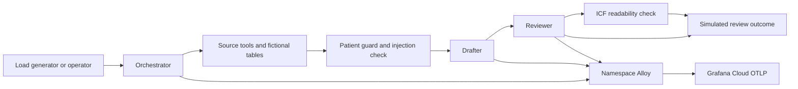

# Regulatory authoring

This opt-in use case drafts sections of an Informed Consent Form (ICF) and a Clinical Study Report
(CSR) from fictional study fixtures. Brindlemoor Therapeutics, brindanib, studies `XQZ-301` and
`XQZ-204`, and every subject and investigator identifier are synthetic. The fixtures demonstrate
controls on generated content; they are not clinical evidence, submission material or a validated
GxP system. CSR sections use a simplified ICH E3-style structure rather than a complete report.

The implementation includes an orchestrator, source retriever, drafter, reviewer and ICF-only
readability agent. The source tools retrieve study facts, fixed tables, section rules and fictional
prior-approved text. Numeric grounding and reading grade are computed in the app. Numeric matching
alone cannot establish whether a clinical claim follows from its source, and reading grade is a
heuristic rather than proof that a consent form is understandable.

Requests return `approved`, `needs_revision` or `escalated`. These are **simulated review outcomes**,
not a human sign-off, an electronic signature or a durable human review workflow. The dashboard's
approval ratio counts those simulated outcomes.

## Select the workload

Set `use_cases` in the module inputs or the complete example's variable file:

```hcl
use_cases = ["regulatory"]
regulatory_name = "dossier"
regulatory_namespace = "dossier"
regulatory_content_capture = false
regulatory_requests_per_minute = 2
```

| `use_cases` | In-cluster workloads |
|---|---|
| `["touchline"]` (default) | Touchline Times only |
| `["regulatory"]` | Regulatory authoring only |
| `["touchline", "regulatory"]` | Both, in separate namespaces with separate collectors |

The gateway, coding-agent host and shared Grafana objects remain independent of this selection.
`agent_host_enabled = false` removes the host; selecting regulatory alone does not remove it.
Regulatory teams `medical-writing`, `regulatory-affairs` and `clinical-science` have their own
Bedrock profiles and do not become gateway teams or Cognito groups.

`regulatory_name` is the resource and telemetry prefix. It must differ from `name`, and neither
prefix may be the other's `-` or `_` prefix. `regulatory_namespace` must differ from `namespace`.
Even with a custom Kubernetes namespace, telemetry keeps `service.namespace=regulatory_name`:
queries below use `dossier`, not the Kubernetes namespace.

Choose the intended Grafana Cloud stack and satisfy [Prerequisites](prerequisites.md) before
applying. A usable regulatory image must already exist in the configured registry. A source
checkout or a chart version alone does not prove that its matching image has been published.
The image is `gc-agento11y-regulatory`, with the shared `images.tag` or an explicit
`images.digests.regulatory` digest. Do not assume older published tags contain this image.

Terraform creates the namespace, three Secrets (OTLP, Agent Observability and experiments), scoped
Pod Identity and the Helm release. With `deploy_workloads = false`, it creates prerequisites and
returns `chart_values_regulatory` for a separate Helm/GitOps installation:

```bash
tofu -chdir=examples/complete output -raw chart_values_regulatory > /tmp/regulatory-values.yaml
helm upgrade --install dossier charts/regulatory --namespace dossier --values /tmp/regulatory-values.yaml
```

Use your configured `regulatory_namespace` in place of `dossier`. The chart reads existing Secrets;
it never creates credentials. See the
[chart reference](https://github.com/rknightion/grafana-cloud-agento11y-demo/blob/main/charts/regulatory/README.md)
and [Terraform reference](reference-terraform.md).

## Request path



Specialists communicate over HTTP; model calls use the regulatory teams' Bedrock application
inference profiles. This chart has no site, Redis or Faro app. Each use case has its own namespace,
Alloy, service accounts and experiments schedule. Regulatory agents' IAM permissions cover only
their own profile/model combinations. Loadgen and experiments do not receive Bedrock permissions.

## Content and controls

| Signal or behaviour | `regulatory_content_capture = false` | `regulatory_content_capture = true` (default) |
|---|---|---|
| Request counts, duration, document type, section, version, simulated review state | Available | Available |
| Deterministic numeric grounding and ICF reading grade | Available | Available |
| SDK usage and estimated model cost | Available when exported | Available when exported |
| Free-form prompt, source, draft and response content in app telemetry | Omitted | Guarded content captured |
| Online content evaluators | No content to score; empty panels are expected | Can score captured content asynchronously |
| Preflight source controls | Enforced | Enforced |

The patient-identifier guard runs before source content reaches the model. Guard errors fail
closed. Tool execution telemetry records the guarded result instead of the raw source. Identifier
redaction and source-note injection detection have separate rules: patient redaction uses priority
20, injection detection priority 10 during warn-first rollout. Synthetic injection notes are deliberate probes, not clinical
source material. A guard failure must not be presented as a successful redact-and-continue result.

Operational metadata includes study identifiers and bounded document/section labels. Metadata mode
still sends the guarded source to the model for inference and returns draft text to the caller;
it controls telemetry capture, not whether drafting occurs. It also does not change shared gateway
capture or account-wide Bedrock invocation logging. See [Security](security.md) before enabling
any additional content path. Keep real patient or investigator data out of this demo in either mode.

## Exercise and inspect

Once installed, check pods and forward the orchestrator (substitute custom prefixes/namespaces):

```bash
kubectl -n dossier get pods
kubectl -n dossier port-forward svc/dossier-orchestrator 8080:8080
```

In another terminal:

```bash
curl --fail-with-body http://localhost:8080/healthz
curl --fail-with-body http://localhost:8080/v1/agent \
  --header 'Content-Type: application/json' \
  --data '{"document_type":"csr","study_id":"XQZ-301","section":"safety_results","variant":"grounded"}'
```

Use an ICF request such as `document_type=icf`, `study_id=XQZ-204`, `section=risks` to exercise
readability. Responses include `request_id`, `agent_version`, `review_state`, `text`, `metrics`
and `usage`. A healthy endpoint alone does not prove Bedrock, guards or export work: inspect a
completed response and its real trace and guard outcome.

Alloy receives OTLP and tails only its own namespace's pod logs. The app's regulatory metrics use
OTLP; there is no extra Prometheus `/metrics` scrape endpoint to configure. SDK generation metrics
provide token/cost data. In Explore, start with:

```promql
sum by (document_type, section, review_state) (
  rate(regulatory_requests_total{service_namespace="dossier"}[10m])
)
```

```promql
sum by (document_type, section) (
  rate(regulatory_number_grounding_ratio_sum{service_namespace="dossier"}[30m])
) / sum by (document_type, section) (
  rate(regulatory_number_grounding_ratio_count{service_namespace="dossier"}[30m])
)
```

```logql
{service_namespace="dossier", service_name="dossier-orchestrator"} | json
```

Open the regulatory dashboard from `tofu -chdir=examples/complete output dashboards`. Widen the
range after downtime. Grounding and reading-grade panels should remain useful in metadata mode;
online content scores should not be expected there. If Application Observability needs a `team`
span-metrics dimension, add it manually in that stack's Application Observability settings; there
is no module/API resource for that setting. The shared App Observability and Knowledge Graph
onboarding objects are not duplicated for regulatory.

## Experiments and traffic

The chart's `traffic.requestsPerMinute` controls synthetic document arrivals, and
`traffic.experimentsSchedule` controls its experiments CronJob. `traffic.enabled = false` scales
loadgen to zero and suspends future experiment jobs. Terraform's `traffic_enabled` applies to
both use cases and the coding-agent host. An already-running request or job can finish; disabling
scheduled traffic does not prevent manual requests.

From `apps/regulatory`, preview suites without cloud calls:

```bash
node experiments/run-experiment.mjs --suite section-prompts
node experiments/run-experiment.mjs --suite guard-policy
```

Adding `--execute` sends real requests using the configured endpoints and credentials and may
incur model/evaluator cost. `section-prompts` compares section drafting variants;
`guard-policy` sends explicit preflight tool-result cases and checks transformed content. A
postflight tool-call result cannot establish preflight source redaction. Scheduled runs use
`--scheduled --execute`. Use the experiment's actual run and time range when presenting results.

## Upgrade, disable and remove

Keep `regulatory_name` and the Kubernetes namespace stable when upgrading. Changing either affects
resource identities and telemetry continuity. Do not remove the permanent Terraform moved blocks
that preserve pre-use-case Touchline addresses. Adding or changing a regulatory image digest does
not enter agent-host user data. A shared `images.tag` change still replaces the host and resets its
local gateway ledger and sign-ins; an existing deployment that pinned non-host digests can also
have the documented one-time replacement on its first upgrade.

For a temporary pause, set `traffic_enabled = false` and apply. To remove only regulatory,
remove `regulatory` from `use_cases`, inspect the plan and apply. With external Helm/GitOps, remove
its release/controller first so it cannot recreate workloads while Terraform deletes prerequisites.
Removing regulatory leaves Touchline, the coding-agent host and shared stack objects according to
their own settings. Telemetry already ingested remains subject to stack retention.
[Teardown](teardown.md) covers full destruction and state recovery.

## Remote guard rollout

The source-note rule starts as `warn` at detector priority 10 without short-circuiting, following the shared guard policy. The app independently
rejects its known injection markers before model input, so a remote warning is not an instruction
to forward unsafe evidence. The guard-policy suite requires a failed evaluation for the exact
source-note rule; an allow response alone cannot pass the probe. Promote the remote rule to deny
only after observing its warning outcomes, reviewing false positives and explicitly authorizing
that enforcement step. The suite expectation must be updated with that intended policy change.

## Verification boundary

Local fixture requests, chart rendering, schema validation and mock-provider plans can establish
implementation behaviour without a cloud deployment. They do not establish live scoring, complete
dashboard data, Knowledge Graph acceptance or clean live teardown. Before calling the end-to-end
use case verified, use an available built image, an explicitly chosen stack and authorized cloud
credentials; run regulatory-only traffic in both capture modes, inspect actual guards, scores,
traces and every dashboard panel, record rendered evidence, and tear down. This guide describes
that procedure and does not claim those live checks have happened.
